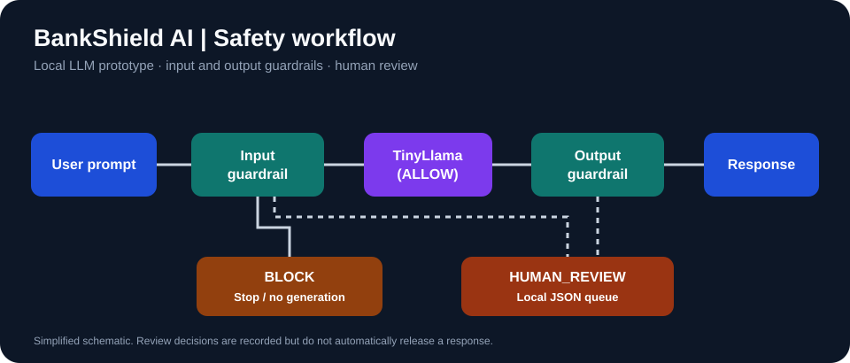

# BankShield AI 🛡️

**Local LLM guardrails and human-review prototype for banking-related conversations**

BankShield AI is an educational Python project that runs a quantised TinyLlama chat model locally and places rule-based safety checks before and after generation. Requests are classified as **ALLOW**, **BLOCK**, or **HUMAN_REVIEW**. Reviewable cases are saved to a local JSON queue and can be approved or rejected by a reviewer.

> **Scope:** This is a prototype demonstrating AI safety engineering, not a production banking system, fraud detection engine, or guarantee against prompt injection, data leakage, or misuse. Do not use real customer information.

## Features

- Input checks for credential theft, malware, phishing, sensitive-data requests, and suspicious security-testing language
- Local inference using `llama-cpp-python` and a TinyLlama GGUF model
- Output checks for obvious secrets, risky instructions, and bank/card number patterns
- Human-review queue and separate reviewer CLI
- A small, reproducible guardrail test suite

## Architecture



**Workflow:** User input → input guardrail → (BLOCK / HUMAN_REVIEW / ALLOW). ALLOW requests reach TinyLlama; generated text passes an output guardrail before being returned. Review cases are written to `review_queue.json`. Reviewer decisions are recorded, **but approval does not automatically release a response**.

## Requirements

- Python 3.11 recommended (Windows supported)
- Sufficient RAM for a local 1.1B quantised GGUF model
- A locally downloaded, legally obtained `tinyllama-1.1b-chat-v1.0.Q4_K_M.gguf` model file
- Internet access only for the initial dependency/model download

## Quick start (Windows PowerShell)

```powershell
py -3.11 -m venv .venv
.\.venv\Scripts\Activate.ps1
python -m pip install --upgrade pip
python -m pip install -r requirements.txt
```

The `llama-cpp-python` package may need a compatible prebuilt wheel or local C++ build tools on some machines. If you already have a working installation, you can keep using that environment.

Place your GGUF model at:

```text
models/tinyllama-1.1b-chat-v1.0.Q4_K_M.gguf
```

Or configure an existing model location without copying it:

```powershell
$env:BANKSHIELD_MODEL_PATH = "C:\path\to\tinyllama-1.1b-chat-v1.0.Q4_K_M.gguf"
```

Run:

```powershell
python bankshield.py
```

Enter a prompt, or type `exit` to quit. To review flagged cases:

```powershell
python -m guardrails.reviewer
```

The JSON review queue is created locally and ignored by Git. Avoid real personal or financial information in prompts.

## Run tests

The original 18-case regression suite tests rule-based input/output classification without requiring the model:

```powershell
python test_guardrails_v2.py
python -m unittest discover -s tests -v
```

The additional tests cover queue creation, reviewer decisions and basic edge cases. They do **not** test the full model or prove resistance to adversarial attacks. See [evaluation notes](docs/EVALUATION.md).

## Repository structure

```text
BankShield_AI/
├── bankshield.py
├── guardrails/
│   ├── input_guardrail.py
│   ├── output_guardrail.py
│   ├── human_review.py
│   └── reviewer.py
├── test_guardrails_v2.py
├── tests/
├── docs/
├── requirements.txt
└── .gitignore
```

## Security and limitations

- Regex rules can miss paraphrases, encodings, and adversarial prompts, or block legitimate educational content.
- Defensive-context heuristics may allow risky prompts if a block rule does not match.
- Output filters are pattern-based, not comprehensive secret/PII detection.
- The local JSON queue has no authentication, encryption, concurrency control or retention policy.
- Reviewer approval records a decision only; it does not resume or release the original request.
- This is a local terminal demonstration, not a secure service or deployment.

## Future improvements

- Add model-in-the-loop integration tests and adversarial evaluation
- Use a structured, access-controlled review backend and avoid storing raw sensitive prompts
- Add observability, audit trails, and false-positive/false-negative metrics
- Add robust prompt-injection evaluation and a safer escalation/release workflow

## Portfolio demo

For a demonstration, record three **synthetic** examples: a safe banking-security question, a blocked credential-theft request, and a security-testing prompt routed to human review. Show the reviewer CLI and test output. Do not include live credentials or customer records.

## License

MIT — see [LICENSE](LICENSE).
